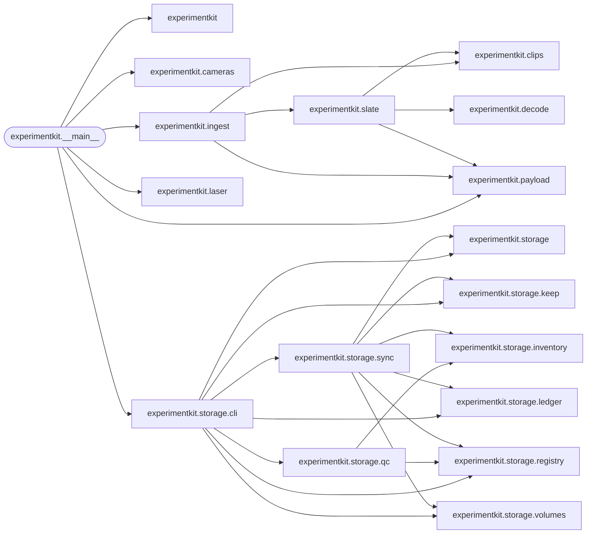

# Code map: Tool-ExperimentManager

*Generated 2026-10-20 from the source by the `code-map` skill; do not edit by hand. Regenerate after changing the code.*

18 modules, 27 imports between them. Arrows point from a module to what it imports; rounded parts hold a command-line entry point.

## Entry points

| Command | Runs |
|---|---|
| `experimentkit` | [`experimentkit.__main__:main`](../experimentkit/__main__.py) |

## How the parts depend on each other

## Modules

| Module | What it is for | Public names |
|---|---|---|
| [`experimentkit`](../experimentkit/__init__.py) | experimentkit: capture at the bench. |  |
| [`experimentkit.__main__`](../experimentkit/__main__.py) | experimentkit -- capture at the bench. | [`cmd_ingest`](../experimentkit/__main__.py#L126), [`cmd_camera_temps`](../experimentkit/__main__.py#L175), [`build_parser`](../experimentkit/__main__.py#L288), [`main`](../experimentkit/__main__.py#L331) |
| [`experimentkit.cameras`](../experimentkit/cameras.py) | Camera temperatures, read straight from the cameras over GenTL. | [`CameraReading`](../experimentkit/cameras.py#L45), [`NodeMapRemote`](../experimentkit/cameras.py#L61), [`read_remote`](../experimentkit/cameras.py#L95), [`default_cti`](../experimentkit/cameras.py#L141), [`Interrupted`](../experimentkit/cameras.py#L147), [`read_all`](../experimentkit/cameras.py#L156), [`read_pco`](../experimentkit/cameras.py#L193), [`read_coaxpress`](../experimentkit/cameras.py#L235), [`log_rows`](../experimentkit/cameras.py#L270), [`append_log`](../experimentkit/cameras.py#L277) |
| [`experimentkit.clips`](../experimentkit/clips.py) | What on a card or in a folder counts as a recording, and which camera made it. | [`LabelError`](../experimentkit/clips.py#L38), [`Clip`](../experimentkit/clips.py#L43), [`find_clips`](../experimentkit/clips.py#L54), [`read_label`](../experimentkit/clips.py#L90), [`camera_for`](../experimentkit/clips.py#L99), [`home_folder`](../experimentkit/clips.py#L117) |
| [`experimentkit.decode`](../experimentkit/decode.py) | Finding the slate's QR codes in a frame. | [`find_codes`](../experimentkit/decode.py#L40) |
| [`experimentkit.ingest`](../experimentkit/ingest.py) | Ingest, stage 1: decide where every clip would go. | [`ClipPlan`](../experimentkit/ingest.py#L39), [`IngestPlan`](../experimentkit/ingest.py#L52), [`plan_ingest`](../experimentkit/ingest.py#L90) |
| [`experimentkit.laser`](../experimentkit/laser.py) | Laser temperatures and status, read (never written) over the laser's serial port. | [`NotAQuery`](../experimentkit/laser.py#L38), [`read_laser`](../experimentkit/laser.py#L51) |
| [`experimentkit.payload`](../experimentkit/payload.py) | The slate's QR payloads, parsed. | [`SlateCode`](../experimentkit/payload.py#L25), [`take_folder`](../experimentkit/payload.py#L40), [`parse`](../experimentkit/payload.py#L45) |
| [`experimentkit.slate`](../experimentkit/slate.py) | Reading the slate out of a clip. | [`Sighting`](../experimentkit/slate.py#L31), [`SlateReading`](../experimentkit/slate.py#L38), [`read_slate`](../experimentkit/slate.py#L121) |
| [`experimentkit.storage`](../experimentkit/storage/__init__.py) | Project storage sync: DaVis projects on C: kept on a work drive and a backup drive. |  |
| [`experimentkit.storage.cli`](../experimentkit/storage/cli.py) | `experimentkit storage ...` -- the commands over sync.py. | [`print_status`](../experimentkit/storage/cli.py#L66), [`project_work_root`](../experimentkit/storage/cli.py#L137), [`print_running`](../experimentkit/storage/cli.py#L142), [`cmd_volume`](../experimentkit/storage/cli.py#L195), [`cmd_add`](../experimentkit/storage/cli.py#L201), [`cmd_status`](../experimentkit/storage/cli.py#L209), [`cmd_drives`](../experimentkit/storage/cli.py#L230), [`cmd_progress`](../experimentkit/storage/cli.py#L248), [`cmd_usage`](../experimentkit/storage/cli.py#L256), [`cmd_deletable`](../experimentkit/storage/cli.py#L308), [`cmd_sync`](../experimentkit/storage/cli.py#L329), [`cmd_qc`](../experimentkit/storage/cli.py#L378) (+7 more) |
| [`experimentkit.storage.inventory`](../experimentkit/storage/inventory.py) | What a DaVis project holds on C: right now: every file, and which files make each recording. | [`FileEntry`](../experimentkit/storage/inventory.py#L40), [`Recording`](../experimentkit/storage/inventory.py#L47), [`set_time`](../experimentkit/storage/inventory.py#L61), [`inventory`](../experimentkit/storage/inventory.py#L72), [`walk`](../experimentkit/storage/inventory.py#L91), [`recordings`](../experimentkit/storage/inventory.py#L114) |
| [`experimentkit.storage.keep`](../experimentkit/storage/keep.py) | Recordings the user wants to stay on C:, however well they are backed up. | [`read_patterns`](../experimentkit/storage/keep.py#L34), [`matches`](../experimentkit/storage/keep.py#L42), [`add`](../experimentkit/storage/keep.py#L58), [`remove`](../experimentkit/storage/keep.py#L73) |
| [`experimentkit.storage.ledger`](../experimentkit/storage/ledger.py) | The record of every copy and every check, kept on the drive beside the copy it describes. | [`Ledger`](../experimentkit/storage/ledger.py#L43), [`hash_file`](../experimentkit/storage/ledger.py#L122), [`copy_hashing`](../experimentkit/storage/ledger.py#L131) |
| [`experimentkit.storage.qc`](../experimentkit/storage/qc.py) | Quality control with every sync: new calibrations and new recordings measured and filed. | [`QCResult`](../experimentkit/storage/qc.py#L34), [`recording_key`](../experimentkit/storage/qc.py#L51), [`validated`](../experimentkit/storage/qc.py#L57), [`seed_from_mirror`](../experimentkit/storage/qc.py#L122), [`run_qc`](../experimentkit/storage/qc.py#L152), [`backfill`](../experimentkit/storage/qc.py#L177) |
| [`experimentkit.storage.registry`](../experimentkit/storage/registry.py) | Which projects on this PC are kept, and on which drives. | [`SyncProject`](../experimentkit/storage/registry.py#L33), [`registry_path`](../experimentkit/storage/registry.py#L58), [`load_projects`](../experimentkit/storage/registry.py#L69), [`add_project`](../experimentkit/storage/registry.py#L81) |
| [`experimentkit.storage.sync`](../experimentkit/storage/sync.py) | Keep each DaVis project snapshotted on the work drive (from C:) and the backup (from work). | [`StageResult`](../experimentkit/storage/sync.py#L72), [`drive_recordings`](../experimentkit/storage/sync.py#L99), [`sync_to_work`](../experimentkit/storage/sync.py#L134), [`sync_to_backup`](../experimentkit/storage/sync.py#L217), [`verify`](../experimentkit/storage/sync.py#L297), [`safely_backed_up`](../experimentkit/storage/sync.py#L343), [`classify`](../experimentkit/storage/sync.py#L356), [`ProjectStatus`](../experimentkit/storage/sync.py#L389), [`status`](../experimentkit/storage/sync.py#L411), [`lower_priority`](../experimentkit/storage/sync.py#L465), [`mirror_qc`](../experimentkit/storage/sync.py#L476), [`running_path`](../experimentkit/storage/sync.py#L499) (+6 more) |
| [`experimentkit.storage.volumes`](../experimentkit/storage/volumes.py) | Drives, known by what they say they are, not by the letter Windows gave them today. | [`Volume`](../experimentkit/storage/volumes.py#L34), [`read_volume`](../experimentkit/storage/volumes.py#L43), [`init_volume`](../experimentkit/storage/volumes.py#L54), [`candidate_roots`](../experimentkit/storage/volumes.py#L74), [`find_volumes`](../experimentkit/storage/volumes.py#L88) |

## Outside dependencies

Imported: `cv2`, `daviskit`, `harvesters`, `markertracker`, `matplotlib`, `numpy`, `projectkit`, `serial`.

**Imported but not declared in pyproject.toml** — a fresh install will fail where these are used, unless they arrive with something else: `daviskit`, `harvesters`, `matplotlib`, `serial`.
